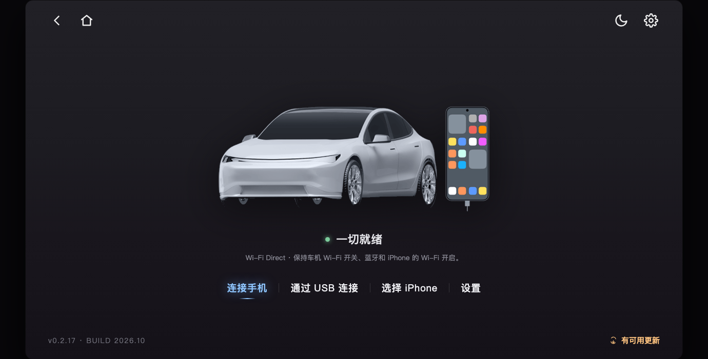

# CarLink

**简体中文** | English

[](https://github.com/deltrivx/CarLink/releases/latest)
[](https://github.com/deltrivx/CarLink)

**CarPlay receiving and projection for Android devices**, with the familiar DiAuto interface.
Package: `net.easyconn.gwmec`.

> This project began in the head-unit world and also fits tablets, phones and other Android
> devices. Features that depend on car hardware and ADB authorisation — the dashboard cluster,
> vehicle data — are available only in that environment.



## What it does

| Feature | Notes |
|---|---|
| CarPlay receiving | Wired (USB) and wireless, with local authentication |
| Wireless | Wi-Fi Direct, the device's hotspot, or Existing Wi-Fi / same LAN |
| Connection on the home screen | Waiting, retry and stop live on the home screen, not on a separate page |
| Display controls | Icon and text size, resolution and frame rate |
| Diagnostics | Local report export; sent only if you choose to share it

## Install

Install on an **Android device** (tablet, phone, head unit). No jailbreak, dongle, Mac, account or
authentication server is required for use. Core CarPlay does not require ADB. The device must
permit APK installation.

The APK supports Android 7.1+ (API 25); Android 7.1–8.1 support is not yet confirmed.

### How to install

Copy the APK to the device and open it from a file manager, or:

```bash
adb install -r CarLink-<version>-generic.apk
```

## Building

```
./gradlew mobile:assembleRelease
```

The release build runs R8 with resource shrinking: only the activities keep their names, because
the manifest points at them by name; everything else is renamed. `Log.v` and `Log.d` are stripped.

Building needs the accessory identity (`offline-mfi/identity.pk8`, `offline-mfi/certificate.p7b`)
and the signing key, passed in through environment variables. These are credentials and are
**not in this repository**.

## License

**GNU General Public License v3.0** — see [LICENSE](LICENSE).

This is a derivative work of **DiPlay** (<https://github.com/shihabal3amri/DiPlay>), itself derived
from **XcertPlay**, both licensed under GPL-3.0. It is therefore distributed under the same terms.

## Not Apple-certified

This is an independent receiver. It uses an experimental accessory identity and is still being
tested for compatibility across iPhones and devices. It is not an Apple-certified product.
